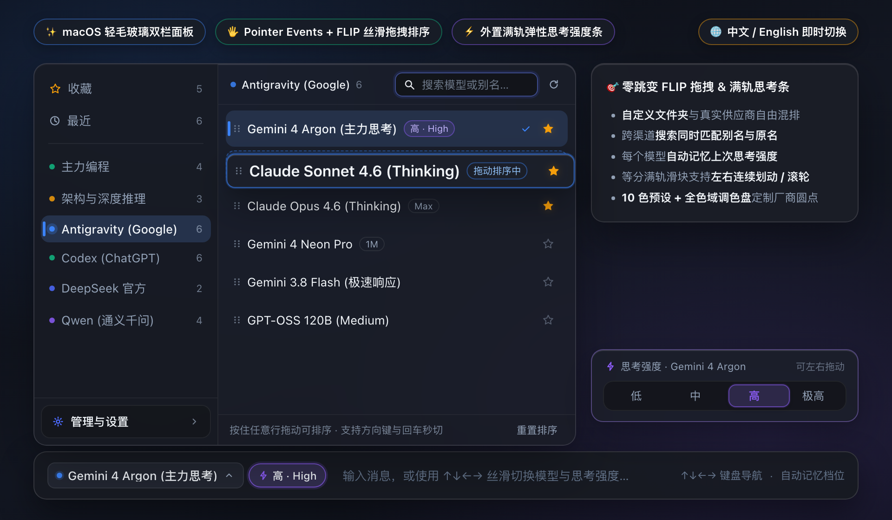
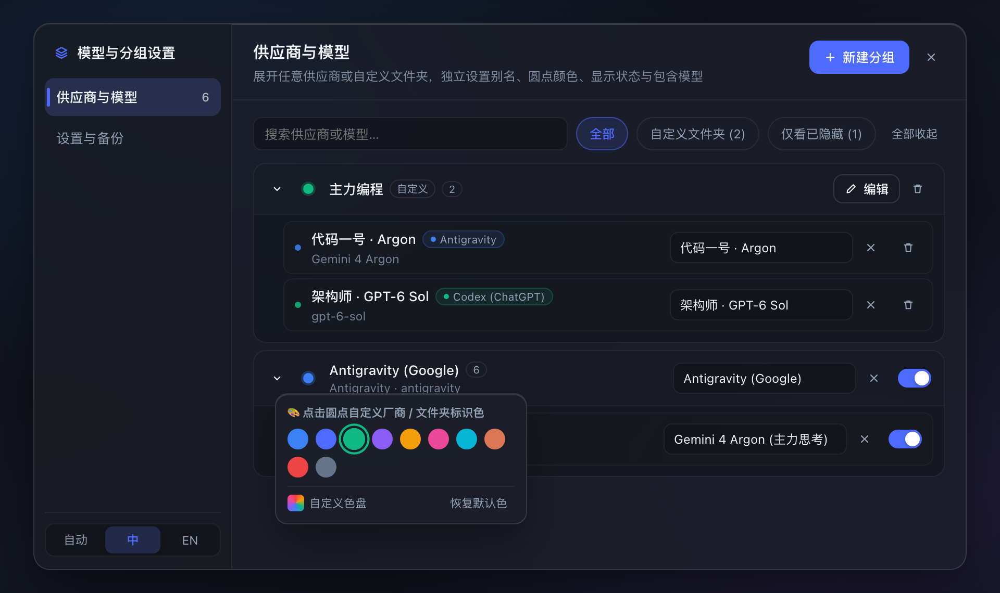
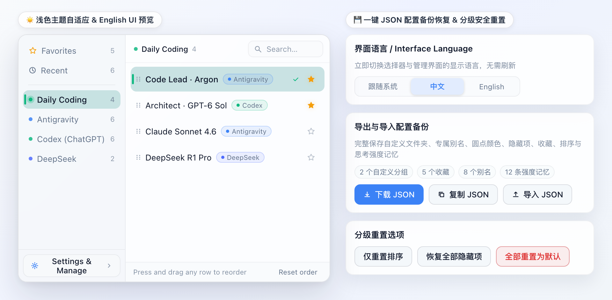

# ✨ dsh-smooth-model-picker · Smooth Model Picker


**[中文](./README.md)** | **English**

> A buttery-smooth two-pane model and reasoning-effort picker plugin for **DeepSeek Harness (`DSH`)**. Replaces the `conversation.input.model` composer slot with a **macOS frosted-glass two-pane popover**, **Pointer Events + FLIP elastic drag-to-reorder**, an **external full-track sliding reasoning-effort scrubber**, **tree-based custom folders with per-folder model aliases**, a **customizable vendor color palette**, and **instant bilingual (`中文` / `English`) switching**.

---

## 🖼️ Preview & Showcase

### 1. Frosted Two-Pane Picker · FLIP Drag-to-Reorder · External Sliding Effort Scrubber



### 2. Tree-Based Management Center · Per-Folder Model Aliases · Vendor Color Swatch Picker



### 3. Adaptive Light Theme · Instant Bilingual UI · One-Click JSON Backup & Granular Reset



---

## 🌟 Key Features

| Feature | Design & Interaction Details |
| :--- | :--- |
| 🎨 **macOS Frosted Glass & Dual-Theme UI** | Translucent frosted glass popover with top inner highlights, a recessed left provider rail, a crisp right model list, warm amber favorite stars, and `6px` vendor accent dots that adapt automatically to DSH dark and light themes. |
| ⚡ **Two-Pane Layout + Instant Search** | Left rail organizes **Favorites / Recent / Custom Folders / Providers**; right toolbar embeds a capsule search box that filters across all channels immediately on typing (matching **folder-specific aliases, global aliases, and raw model IDs**). |
| 🖐 **Pointer Events + FLIP Drag-to-Reorder** | Replaces native HTML5 `draggable` with a custom Pointer Events engine: hold and move past `5px` to lift a frosted floating card while siblings displace elastically via GPU `translate3d`, settling with zero layout jump on release, edge auto-scroll, and `Esc` to cancel. |
| 🧠 **External Full-Track Sliding Effort Capsule** | Whenever the active model exposes `reasoning.efforts`, an adjacent width-locked capsule appears next to the model trigger in the composer; click to open an equal-width segmented scrubber supporting **press-and-drag horizontal scrubbing, click, mouse wheel, and arrow keys**, with **automatic per-model effort memory**. |
| 📁 **Custom Folders + Per-Folder Model Aliases** | Group models across different providers into custom folders (virtual providers), and assign **independent folder-scoped aliases** to the same model in different folders without overwriting its original provider alias. |
| 🎨 **10-Color Swatches + Full-Spectrum Color Picker** | Click any provider or folder color dot in the management modal to pick from 10 curated brand swatches, open the system full-spectrum color picker, or reset to default brand colors with one click. |
| 🌐 **Instant Bilingual Switch (`Auto / 中文 / EN`)** | Built-in Chinese and English localization; switch languages live from the management modal sidebar or Settings & Backup tab without reloading the page. |
| 💾 **JSON Backup/Restore + Granular Reset** | Download or copy full JSON backups, restore from a file or pasted JSON with schema validation, or use 3-tier granular reset (`Reset order only`, `Unhide all items`, or two-step `Reset all to defaults`). |

---

## 🚀 Installation

### Option 1: Install via DSH Plugin Market (Recommended)

Open **Plugins → Plugin Market (or Discover)** inside DSH, search for **`dsh-smooth-model-picker`**, and click **Install**.

### Option 2: Install from GitHub Release Prebuilt Tarball (Fastest, Zero Build)

```bash
# Replace <profile> with your active DSH profile (e.g. desktop or web)
dsh plugin --profile <profile> add https://github.com/RuneYang123/dsh-smooth-model-picker/releases/download/v0.1.0/dsh-smooth-model-picker-0.1.0.tgz
```

### Option 3: Install Directly from GitHub Repository

```bash
dsh plugin --profile <profile> add github:RuneYang123/dsh-smooth-model-picker
```

---

## ⌨️ Keyboard & Pointer Shortcuts

| Context | Action / Key | Behavior |
| :--- | :--- | :--- |
| **Search input / Model list** | `↑` / `↓` | Move highlight cursor up or down across model rows |
| **Search input / Model list** | `←` / `→` | Switch focus between the left provider/folder rail and the right model list |
| **Search input / Model list** | `Enter` | Select the highlighted model immediately and close the popover |
| **Providers / Models / Favorites** | Press & drag (`>5px`) | Start Pointer Events + FLIP drag-to-reorder (`Esc` cancels active drag) |
| **Reasoning-effort capsule / Track** | Click / Scrub / Wheel / `←` `→` | Switch active model reasoning effort smoothly and remember per model |
| **Manage Modal → Color Dot** | Left click | Open the 10-color swatch popover and custom full-spectrum color picker |

---

## 💡 Notes & Troubleshooting

1. **Slot Exclusivity (`conversation.input.model`)**
   - This plugin registers the `conversation.input.model` slot (`priority: -1`). If you previously installed another model-picker plugin (such as `dsh-model-quick-switch`), disable or uninstall it first to avoid slot conflicts.
   - **Automatic Migration**: Existing favorites, recent models, and ordering from `dsh-model-quick-switch` are migrated automatically on first run.
2. **Missing a provider or model?**
   - Open **`⚙ Settings & Manage` → `Providers & Models`** and click **`Hidden Only`** in the filter bar to check whether that provider or model has its visibility switch turned off.
3. **Zero Dependencies & Local Privacy**
   - Pure client-side UI plugin with zero runtime dependencies and no external network calls. All preferences are stored locally in browser `localStorage` under `dsh.smooth-model-picker.v1`.

---

## 🛠️ Development & Verification

```bash
# 1. Static syntax check
npm run check

# 2. Run sandbox smoke & unit tests
npm test

# 3. Pack prebuilt release tarball (.tgz)
npm pack
```

---

## 📄 License

Released under the [MIT License](./LICENSE).
