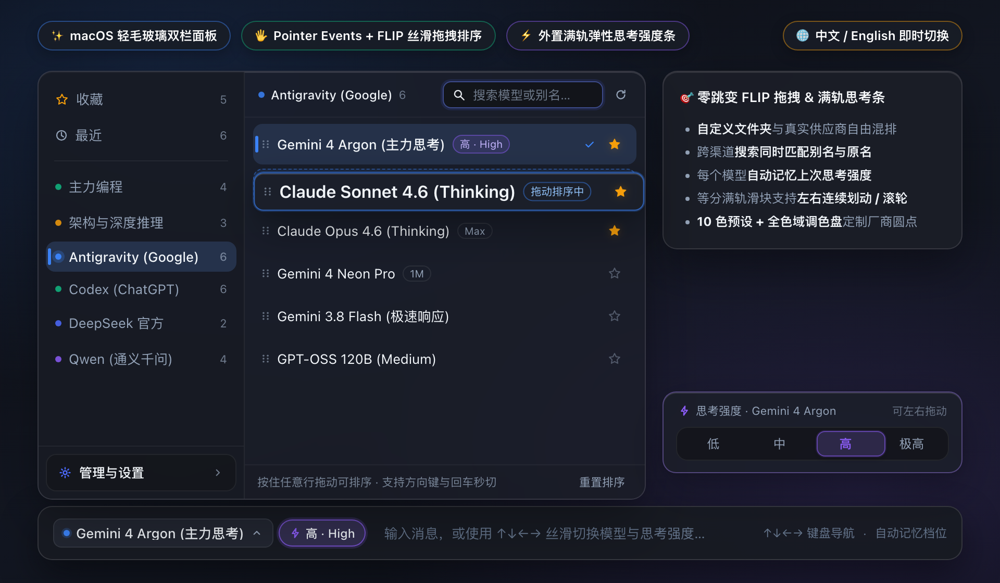
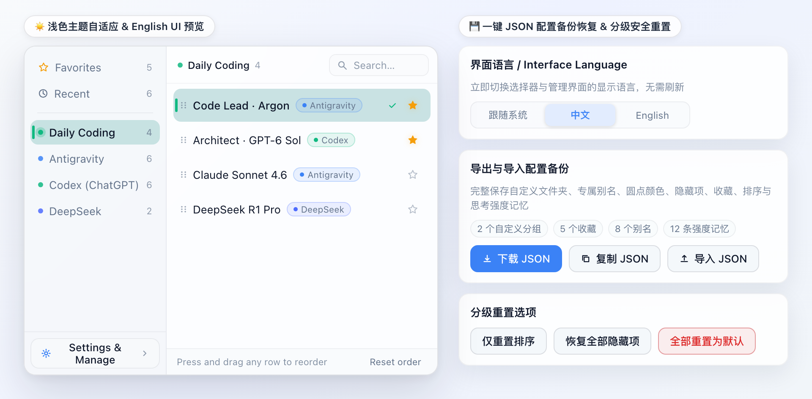

# ✨ dsh-smooth-model-picker · 丝滑模型选择器


**中文** | **[English](./README.en.md)**

> 面向 **DeepSeek Harness (`DSH`)** 的高顺滑双栏模型与思考强度选择器插件。接管对话输入框 `conversation.input.model` 插槽，带来 **macOS 轻毛玻璃双栏面板**、**Pointer Events + FLIP 弹性拖拽排序**、**输入框外置满轨划动思考强度条**、**树状自定义文件夹与专属别名管理**、**厂商圆点调色盘** 以及 **中英文即时切换**。

---

## 🖼️ 界面预览与效果展示 (Preview & Showcase)

### 1. 双栏毛玻璃主面板 · FLIP 丝滑拖拽排序 · 外置满轨思考强度条



### 2. 树状管理与设置中心 · 自定义文件夹独立别名 · 厂商圆点调色盘


### 3. 浅色主题高对比度自适应 · 中英双语即时切换 · 一键 JSON 备份与分级重置



---

## 🌟 核心亮点

| 模块 | 设计与交互细节 |
| :--- | :--- |
| 🎨 **macOS 轻毛玻璃 + 双主题自适应** | 半透明磨砂玻璃面板搭配顶部内高光、柔和沉底左栏与清透右栏、琥珀金收藏星标及 `6px` 厂商微色点，原生适配 DSH 深色与浅色主题。 |
| ⚡ **双栏分区 + 打开即搜** | 左栏聚合 **收藏 / 最近 / 自定义文件夹 / 真实供应商**；右栏顶栏内嵌胶囊搜索框，打开面板即可直接打字跨渠道检索（同时匹配**文件夹专属别名、全局别名与原始模型 ID**）。 |
| 🖐 **Pointer Events + FLIP 弹性拖拽** | 彻底告别生硬的原生 HTML5 `draggable`：按住移动超过 `5px` 自动升起毛玻璃悬浮卡片，其余行通过 GPU `translate3d` 丝滑弹性让位，松手同步落位零跳变，支持边缘自动滚动与 `Esc` 取消。 |
| 🧠 **外置满轨划动思考强度胶囊** | 当所选模型支持 `reasoning.efforts`（思考强度/推理档位）时，输入框模型按钮旁自动展现锁宽快捷胶囊；点击展开等分满轨滑块浮层，支持**按住左右连续划动（Scrubbing）、点击、滚轮、方向键**切换，并**按模型独立记忆上次档位**。 |
| 📁 **自定义文件夹 + 文件夹内独立别名** | 支持跨真实供应商把常用模型组合进自定义文件夹（虚拟供应商），并允许同一个模型在**不同自定义文件夹与原供应商下拥有各自独立的专属别名**，互不覆盖。 |
| 🎨 **厂商圆点 10 色预设 + 全色域取色** | 在管理面板点击任意供应商或文件夹前的彩色圆点，即可从 10 种精选品牌色中一键切换，或唤起系统全色域调色盘自由定制，支持一键恢复默认品牌色。 |
| 🌐 **中 / 英 / 跟随系统 即时切换** | 内置完整中文与英文界面文案，可在管理面板左下角或「设置与备份」页一键切换 `自动 / 中文 / EN`，无需刷新页面立即生效。 |
| 💾 **JSON 备份恢复 + 分级安全重置** | 支持一键下载或复制 JSON 配置文件、选择文件或粘贴文本校验导入；提供「仅重置排序」「恢复全部隐藏项」「二次确认全部重置」三级安全重置。 |

---

## 🚀 安装指南

### 方式一：通过 DSH 插件市场一键安装（推荐）

在 DSH 内打开 **插件（Plugins） → 插件市场（Plugin Market / Discover）**，搜索 **`dsh-smooth-model-picker`** 或 **`丝滑模型选择器`**，点击安装即可。

### 方式二：从 GitHub Release 预构建包安装（免构建、秒装）

```bash
# 将 <profile> 替换为你实际使用的 profile（桌面端通常为 desktop，网页端通常为 web）
dsh plugin --profile <profile> add https://github.com/RuneYang123/dsh-smooth-model-picker/releases/download/v0.1.0/dsh-smooth-model-picker-0.1.0.tgz
```

### 方式三：从 GitHub 仓库直接安装

```bash
dsh plugin --profile <profile> add github:RuneYang123/dsh-smooth-model-picker
```

> [!TIP]
> **DSH Desktop 桌面端用户提示**：桌面客户端默认运行在 `desktop` profile 下。如果你在终端用 `--profile web` 安装，插件会装进网页端 profile 而不会出现在桌面端；建议直接在桌面端 **插件** 页面内操作，或在命令行指定 `--profile desktop`。

---

## ⌨️ 快捷键与手势速查

| 交互位置 | 操作 / 按键 | 效果说明 |
| :--- | :--- | :--- |
| **主面板搜索框 / 模型列表** | `↑` / `↓` | 在当前模型列表中上下移动高亮游标 |
| **主面板搜索框 / 模型列表** | `←` / `→` | 在左栏（收藏/最近/文件夹/供应商）与右栏模型列表之间无缝切换 |
| **主面板搜索框 / 模型列表** | `Enter` | 立即选中高亮模型并关闭弹窗 |
| **左栏供应商 / 右栏模型 / 收藏** | 按住并拖动 (`>5px`) | 启动 Pointer Events + FLIP 弹性拖拽排序（拖动中按 `Esc` 取消） |
| **输入框思考强度胶囊 / 滑轨** | 点击 / 左右划动 / 滚轮 / `←` `→` | 丝滑切换当前模型思考强度档位，并自动按模型持久化记忆 |
| **管理面板 → 彩色圆点** | 鼠标左键点击 | 打开 10 色预设色板与全色域自定义取色器 |

---

## 💡 注意事项与常见问题 (FAQ)

1. **与其他模型选择器插件互斥**
   - 本插件接管 `conversation.input.model` 插槽（`priority: -1`）。如果此前安装过其他同类模型选择器插件（如 `dsh-model-quick-switch`），请先在「插件」页将其禁用或卸载，避免插槽冲突。
   - **无缝迁移**：首次加载时会自动读取并迁移 `dsh-model-quick-switch` 的收藏、最近记录与排序偏好。
2. **为什么主面板里看不到某个供应商（如 `Codex (ChatGPT)`）或模型？**
   - 打开选择器左下角 **`⚙ 管理与设置` → `供应商与模型`**，点击筛选栏的 **「仅看已隐藏」**，检查该供应商或模型右侧的显示开关是否被关闭；打开开关即可立即恢复显示。
3. **思考强度胶囊什么时候会显示？**
   - 当当前所选模型在 DSH 模型目录中声明了 2 个及以上的 `reasoning.efforts` 档位时，输入框旁会自动显示思考强度胶囊；普通无推理档位的模型会自动隐藏胶囊，保持输入区清爽。
4. **隐私与安全性如何？**
   - **零外部运行时依赖、零网络请求**：插件仅包含纯前端 UI 交互代码，所有排序、分组、别名与思考强度记忆均保存在浏览器本地 `localStorage`（键名：`dsh.smooth-model-picker.v1`），绝不修改 DSH 底层模型配置或上传任何数据。

---

## 🛠️ 本地开发与自检

```bash
# 1. Node 语法静态检查
npm run check

# 2. 运行沙箱冒烟与全量单元测试（拖拽物理计算、滑轨计算、配置清洗与备份回环、组件渲染）
npm test

# 3. 生成预构建发布包 (.tgz)
npm pack
```

---

## 📄 开源许可

本项目基于 [MIT License](./LICENSE) 开源。
